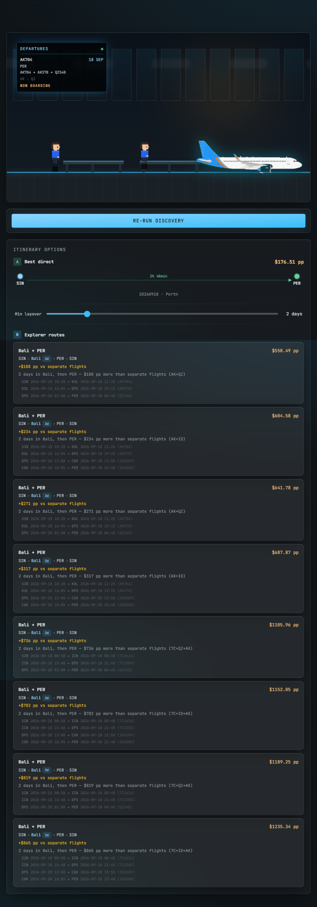
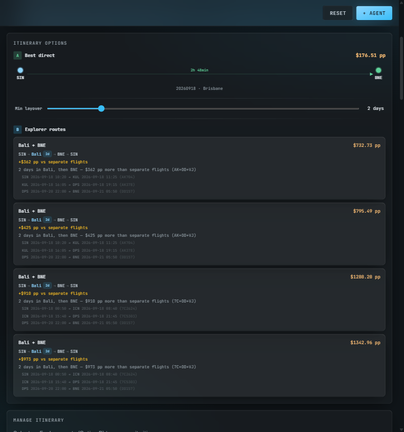
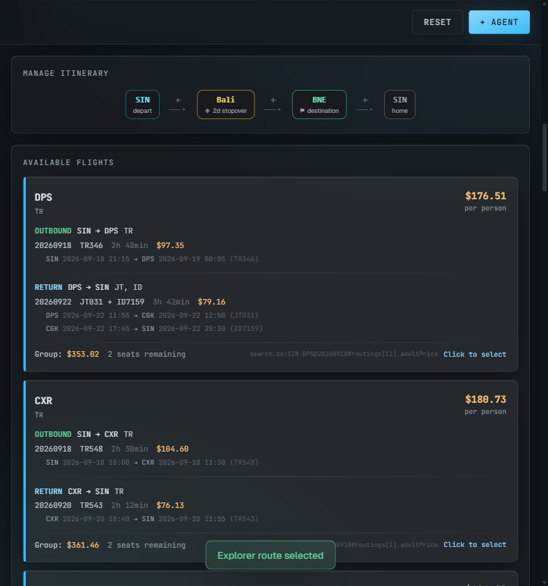

# Partynerary

**An autonomous group-travel agent that turns "where should we all go?" into a priced, seat-checked flight itinerary.**

Each friend in the group gets their own agent, carrying their calendar, budget ceiling and travel vibe. The agents negotiate a date everyone can make, search real flight inventory, and come back with ranked options, including multi-city routes with a stopover that satisfy people the cheapest trip left out. The group makes **one decision**; everything before and after it is agent work.



## Highlights

- **No invented prices.** Every fare on screen is a pointer into a real flight-search API response (for example `search.do:SIN-DPS@20260918#routings[11].adultPrice`), not text a model wrote. The agent message schema has no amount field at all.
- **Date consensus by negotiation.** Member agents read each person's calendar (`.ics`) and concede round by round until everyone accepts a departure date.
- **Vibe matching.** Free-text preferences ("beaches, street food") are matched to destinations with vector retrieval over a prebuilt embedding file, before any flight search runs.
- **Budget ceilings are absolute.** A member grants a spending ceiling, never a wallet. A ceiling can veto a trip and is never out-voted or rounded.
- **Multi-city reconciliation.** When the winning trip leaves someone's preference unmet, the engine searches hub routes (for example SIN → Bali → PER) and prices the difference against separate flights.
- **Repair loop.** If a fare or date changes after the group commits, the system works out who is affected and re-plans cheapest change first.

## Screenshots

| Itinerary options | Manage itinerary |
|---|---|
|  |  |

## Tech stack

- **Backend:** Python 3.14, standard library only at runtime (`http.server`, threading). There are no pip installs to run it.
- **Frontend:** Next.js 14 (static export) with React 18 and Tailwind CSS, served by the same Python process.
- **Flights:** the Atlas flight-search sandbox API.
- **Embeddings:** `sentence-transformers/all-MiniLM-L6-v2`, used only at build time to generate `data/vectors.json`.

## Getting started

You need Python 3.14+, Node.js 18+, and Atlas sandbox credentials.

```bash
git clone https://github.com/educatedgrape/Partynerary.git
cd Partynerary

# 1. Add your Atlas sandbox credentials
cp .env.example .env        # then fill in ATLAS_CLIENT_ID and ATLAS_CLIENT_SECRET

# 2. Build the web UI
cd web && npm install && npm run build && cd ..

# 3. Start the dashboard
python -m src.ui.dashboard   # then open http://localhost:8080
```

Options: `--port 8080`, `--origin SIN`, `--party-size 2`.

## Running the tests

The test suite runs offline against recorded API responses in `fixtures/`, so it needs no credentials:

```bash
python -m unittest discover -s tests -t .
```

## Project structure

```
src/
  agent/       decision log, booking executor and its safety gates
  agents/      per-member agents and their pitches
  atlas/       flight-search API client, response models, cache
  booking/     re-pricing and post-booking aftercare
  discovery/   vibe retrieval, flight sweep, scoring, multi-leg routes
  itinerary/   dependency graph, change propagation, re-planning
  party/       members, calendars, date negotiation, orchestrator
  ui/          dashboard HTTP server and receipt rendering
web/           Next.js frontend
tests/         unit and integration tests
fixtures/      recorded API responses for offline tests
probe/         scripts that measure which routes the API covers
tools/         build-time scripts (embeddings, dataset generation)
data/          destination catalogue and embeddings
```

## Notes

This is a prototype built against a sandbox API. No real bookings or payments are made.
